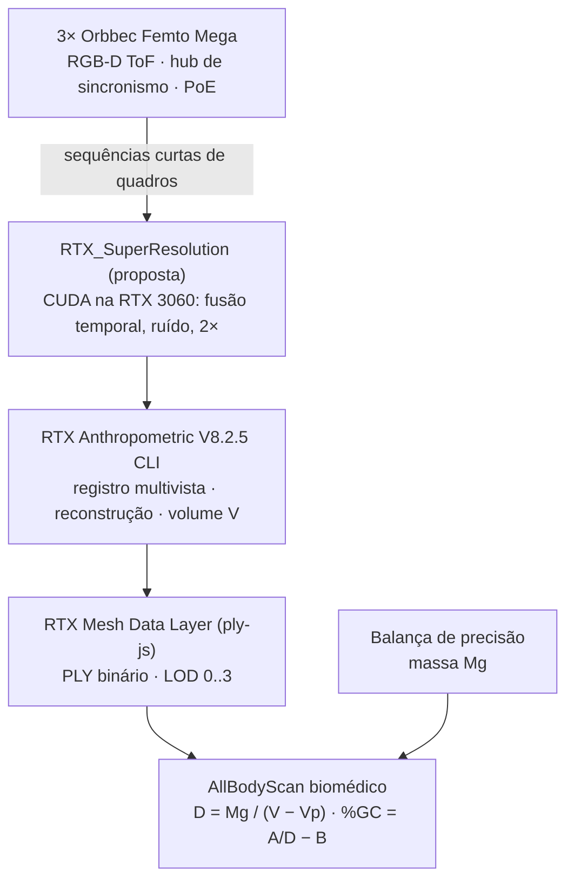

# Scanner-LAOB

> Scanner corporal 3D do Laboratório LAOB: reconstrói o corpo para medir o volume e, com a massa da balança, calcula a densidade corporal e o percentual de gordura.

 -76B900) 

> [!NOTE]
> **Estado (nov/2026):** a versão funcional de referência é a **RTX Anthropometric V8.2.5 CLI**.
> O módulo de super-resolução (RTX_SuperResolution) e a instalação dos 3 Orbbec Femto Mega no arco
> ainda são **estudos**: nada foi implementado nem medido, e o trabalho aguarda a chegada dos sensores.

## Sobre

O scanner mede o volume do corpo com uma reconstrução 3D multivista. Esse volume, junto com a massa
medida numa balança de precisão, dá a densidade corporal, e dela sai o percentual de gordura
(equação do tipo Siri, com correção do volume pulmonar). Este repositório reúne a documentação
técnica do sistema, consolidada a partir do material do Prof. Mario Gazziro.

## Funcionalidades

- Captura o corpo com 3 sensores RGB-D sincronizados (proposta).
- Melhora os quadros com fusão temporal, redução de ruído e super-resolução 2× em CUDA (proposta).
- Reconstrói a malha 3D, repara buracos e mede o volume (RTX Anthropometric V8.2.5).
- Armazena a malha em PLY binário com níveis de detalhe LOD 0 a 3.
- Calcula densidade e %GC pelo modelo biomédico do AllBodyScan.

## Arquitetura



Só a malha científica (LOD 0, sem simplificação) é usada para volume e %GC; os outros níveis servem
para visualização e transporte.

## Requisitos

| Item | Especificação |
| :--- | :--- |
| Sensores | 3× Orbbec Femto Mega: profundidade 1024×1024, 120°×120°, até 25 fps, 0,25–2,21 m; RGB 4K 80°×51° |
| Posições (mm) | FM-01 (−1110, 1100, −310) · FM-02 (+1110, 1100, +310) · FM-03 (0, 2130, −280), inclinada −72,7° |
| Arco (CAD) | 2554 × 2246 × 842 mm |
| GPU | NVIDIA RTX 3060 (Ampere, CC 8.6, 12 GB) |
| Balança | Balança de precisão para a massa corporal |
| Equação de gordura | `%GC = A/D − B` com 8 pares (A, B) por sexo/etnia; Siri clássica = 495/450 |

## Documentação

| Documento | Conteúdo |
| :--- | :--- |
| [Visão geral](docs/scanner-3d/README.md) | Índice e resumo do sistema |
| [Arquitetura](docs/scanner-3d/arquitetura.md) | Componentes, fluxo de dados, níveis de detalhe (LOD) |
| [Instalação dos sensores](docs/scanner-3d/instalacao-sensores.md) | Posições no arco, sincronismo, PoE |
| [Super-resolução](docs/scanner-3d/super-resolucao.md) | Matemática (Cuba, 2014) e plano CUDA na RTX 3060 |
| [Modelo biomédico](docs/scanner-3d/modelo-biomedico.md) | Volume pulmonar, densidade, %GC e exemplo numérico |
| [Histórico e referências](docs/scanner-3d/historico-e-referencias.md) | Do laser (2005) ao RGB-D (2014) e ao sistema atual |
| [posicoes_3_femto_mega.csv](docs/scanner-3d/posicoes_3_femto_mega.csv) | Coordenadas propostas dos sensores |

## Estrutura do projeto

```text
Scanner-LAOB/
├── docs/scanner-3d/   # documentação técnica completa
└── README.md
```

## Roadmap

- [ ] Receber e instalar os 3 Femto Mega no arco.
- [ ] Implementar e medir a RTX_SuperResolution na RTX 3060.
- [ ] Validar volume e %GC contra a versão de referência V8.2.5.

## Equipe

Desenvolvido no **Laboratório LAOB**.

- Prof. Mario Gazziro
- Victor Colombo

## Licença

Uso interno do LAOB — todos os direitos reservados.
